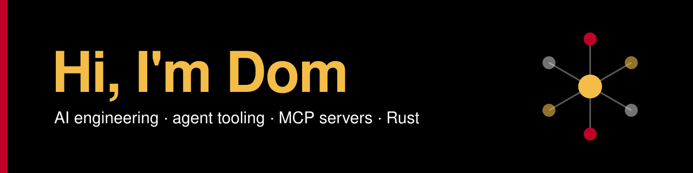
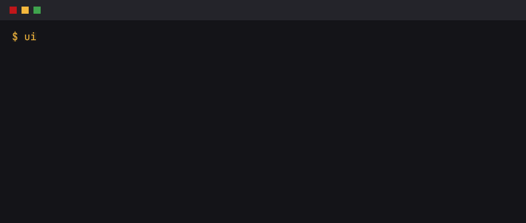
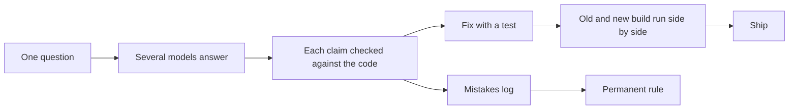

  

  AI engineering · Agent tooling and MCP servers in Rust · Support and systems administration · Open to remote work (US)

  
  

  
  
  
  

## What I build

I work in support and systems administration, and most of what I build now is the tooling around AI coding agents. I write the rules the agents work under and the MCP servers that give them a few bounded tools. I also build the checks that prove a result on the real system before I accept it. An agent will call a job finished when it only looks finished, and I found that out more than once.

- **MCP servers and agent tools.** Small Rust servers that give an agent a short list of tools. Each tool has a limit on what it can read, write and run.
- **Review by many models.** One prompt goes to 16 models from 6 providers at the same time. A finding counts only after an agent opens the file and reads the line it cites. In August 2026 an agent checked one flagship model's confident findings that way, and about half of them were wrong.
- **Guardrails outside the model.** A rule in a file can be ignored, so hooks run before a tool call. A shell command that deletes files opens a dialog first, a guard refuses a force push, and API keys stay in an encrypted vault.
- **Tests an agent can read.** A headless terminal captures what a program drew as an image, as text and as data. An agent can then check an interface without taking over my screen.
- **Local models.** Speech to text on whisper.cpp, image generation on MLX and a document index on LanceDB, all on an Apple Silicon Mac.

This is UI-Test-Mac, one of the private projects listed further down, testing the calculator bc. It runs bc on a terminal that no window shows, types 6*7 and waits until 42 is on the screen. Then it quits and prints what the screen held at the end, so the result can be read as text.

## How a change gets accepted

The models miss different things. In one review, ten models answered, and one bug showed up in only one of the ten reviews. That review ended in 19 fixes. After a fix, the old build runs first as a control. If the old build does not show the fault, the check is wrong and gets fixed before anything else. When something still goes wrong, it goes into a mistakes log. A mistake that shows up three times becomes a rule that every agent loads.

## Selected private work

These repositories are private, so the tables have no links.

| Project | What it does | Built with |
|---|---|---|
| Agent Wrangler | Desktop app that runs several coding agents at once, each in its own folder. Every permission request lands in one inbox, and each agent can get a token or dollar budget | TypeScript, Claude Agent SDK, Codex CLI |
| orange-mcp | MCP server that gives agents seven bounded analytics tools with provenance files. A Rust server owns the protocol and the limits, and a short-lived Python worker does the statistics | Rust, Python, Orange |
| Multi-model broadcast | Sends one prompt to 16 models from 6 providers in parallel, each with its own timeout. The answers land side by side in one file | Shell |
| UI-Test-Mac | Runs a program on a terminal that no window shows and sends it a script of steps. It captures the screen as an image, as text and as data | Rust |
| token-vault | GPG vault for API keys that unlocks with Touch ID or the Mac password. When an agent needs a key and the vault is locked, I get the unlock popup | Rust, shell, GPG |
| docrag | Turns PDFs, Office files and images into Markdown and JSON and checks every page on its own. It indexes the result for cited retrieval on the local machine | Python, Docling, LanceDB |
| mflux-mcp | MCP server for local image generation with Flux and Z-Image on Apple Silicon | Python, MLX |
| git-understand | Turns a repository's structure and git history into diagrams and charts | Rust |
| Log readers | Read-only scanner and MCP server for the Loki log store in my homelab | Rust |
| Product and stock finder | Finds the lowest verified price across more than 40 US retailers and six pharmacies. It checks the winning page again live and never buys or logs in | Rust |
| whisper-transcribe | Drag-and-drop transcription and summary on macOS with the large-v3 model | whisper.cpp, shell |

| Systems and security tools | What it does | Built with |
|---|---|---|
| VeloVM | VM manager for Apple Silicon with three engines behind one library. It runs no background daemons and has a native app | Rust, Swift |
| IP Intel | Checks an address against 14 threat-intelligence sources and gives one verdict. A source that fails is never counted as clean | Rust |
| MetaScope | File metadata and forensic inspection in a terminal UI and a native app. Everything stays on the machine | Rust |
| nab | Wi-Fi and home network diagnostics in a terminal UI | Rust |

The line and test counts at the top come from 29 of my own projects, counted on 2026-11-25. Lines are the Rust in the files git tracks, without build output or lockfiles. Tests are test functions found by pattern, not the result of a test run.

## Support and sysadmin tools

My day job is support and systems administration. These tools came out of that work, and they are the ones I have made public.

  
  
  
  

A read-only command-line tool for Mac support work. It reads the crash reports, panic records, unified log and live state that macOS already keeps, then gives one list of problems sorted by severity, with a next step for each. It also builds a double-click MacSecurity.app that runs the security audit and writes an HTML report.

Screenshot

  
  
  
  

Checks one Mac for 30 common security gaps in Jamf-managed Macs. It changes nothing and writes a private HTML report. The whole audit is a single JavaScript for Automation script, so it runs on stock macOS with no Python, Homebrew or Jamf credentials.

Screenshot

  
  
  

A Rust replacement for the postinstall script in Microsoft's Office for Mac License Removal Tool 2.7. The original had two faults: the flight reset never ran, and the keychain deletes did not remove the user's sign-in items. This one fixes both, and it runs as a native app, as a terminal UI or from the command line.

Screenshot

  
  
  
  

A native cleanup app for Macs with Apple silicon, written in Rust. It shows where the space on the startup disk goes. It finds caches, leftover installers, large old files and build folders, and moves only what you review to the Trash. It is one self-contained app, so it also runs straight from a disk image or a thumb drive.

Screenshot

  
  
  
  

macOS 27 removed the CUPS web page at localhost:631, the place to manage printers and print queues in a browser. This is PaperCut's open-source replacement, packaged for the Mac. It adds a double-click installer, a server that runs only while the page is open, and a set of bug, security and speed fixes. It is an unofficial packaging, not published or supported by PaperCut.

Screenshot

## What I work with

  

## Contact

The fastest way to reach me is [LinkedIn](https://www.linkedin.com/in/dominic-f-/). If one of these tools saved you some time, or broke on your Mac, I would like to hear about it either way.
